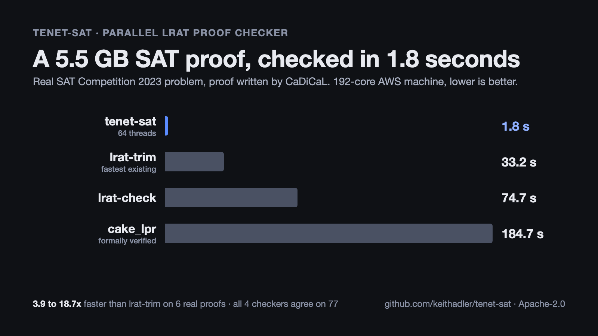

<div align="center">

# tenet-sat

### Check SAT proofs on every core at once

**A parallel LRAT proof checker.** Give it a formula and a proof that the formula has no solution;
it checks the proof with many threads, 4 to 19 times faster than the fastest existing checker on real proofs.




**[Performance](docs/PERFORMANCE.md)** · **[Use](#use)** · **[How it works](#how-it-works)** · **[What it is not](#what-it-is-not)** · **[Prior art](#prior-art)**

</div>

## In plain English

A SAT solver that says "this problem has no solution" can back that claim with a proof: a list of steps, each
deriving a new clause from earlier ones, ending in a contradiction. Checking that proof is how you trust the
answer without trusting the solver. Modern solvers such as CaDiCaL write the proof in **LRAT**, where every step
names exactly the earlier clauses it uses.

That detail means the steps can be checked **independently, all at once**, except for one thing: clauses are
deleted along the way, and a step must not use a clause that was already gone. tenet-sat reads the proof in large
batches and, before checking anything, stamps every clause about to be deleted with the first step that deletes it.
Each step can then answer "was this clause still alive for me?" with a single comparison, and every step in the
batch is checked in parallel.

## Results

On six real proofs of SAT Competition 2023 problems, written by CaDiCaL (0.5 to 7.1 GB), on a 192-core AWS machine,
with default settings. Seconds, lower is better.

| Proof | Size | **tenet-sat** | lrat-trim | lrat-check | cake_lpr (verified) | vs lrat-trim |
|---|---:|---:|---:|---:|---:|---:|
| 036b | 0.53 GB | **0.66** | 2.54 | 5.97 | 16.78 | 3.9x |
| abe8 | 1.24 GB | **0.90** | 6.98 | 16.61 | 41.43 | 7.8x |
| 65b1 | 2.45 GB | **1.63** | 8.31 | 26.56 | 85.10 | 5.1x |
| 953e | 5.49 GB | **1.77** | 33.16 | 74.65 | 184.66 | **18.7x** |
| bc7d | 6.48 GB | **3.65** | 22.22 | 66.91 | 243.89 | 6.1x |
| e5a7 | 7.11 GB | **4.23** | 23.82 | 73.73 | 252.85 | 5.6x |

- **Correct on the same data.** All 77 proofs generated verify with tenet-sat (at 1 and 64 threads), lrat-check,
  lrat-trim and cake_lpr. On 600 deliberately corrupted proofs, tenet-sat and cake_lpr gave the same verdict every time.
- **The speed comes from cores.** On one core tenet-sat is about as fast as lrat-trim, at worst half as fast.
- **It is fastest at 48 to 64 threads** on this two-processor machine and slower at 192.

Method, scaling tables, what each optimization bought, and the limits: **[docs/PERFORMANCE.md](docs/PERFORMANCE.md)**.

## Use

Needs the .NET 10 SDK to build. The published Linux binaries need nothing installed.

```bash
dotnet build -c Release
```

```bash
dotnet src/TenetSat/bin/Release/net10.0/tenetsat.dll check formula.cnf proof.lrat
```

Prints `s VERIFIED` (exit 0) or `s NOT VERIFIED` (exit 1) with the first failing step. Exit 2 is a usage or I/O
error. The proof may be text or binary LRAT; the format is detected.

| Option | Default | Meaning |
|---|---|---|
| `--threads N` | all cores, at most 64 | worker threads. On a 2 x 96-core machine 48 to 64 was fastest and 192 about 2x slower ([details](docs/PERFORMANCE.md#threads)); try a few values on yours |
| `--batch-mb M` | 1024 | proof bytes per batch. Memory grows with it; below 256 every phase is slower |
| `--read` | off | read text proofs with file reads instead of a memory map. No faster in any test here; kept for systems where mapping large files is slow |

The `c` lines say where the time went: `parse`, `register` (adding clauses, stamping deletions, dropping deleted
clauses), `check`, `sequential` (per-batch bookkeeping on one thread) and `cnf` (loading the formula), then
garbage-collector counts and pause time. Wall-clock time also includes starting the process and returning memory
at exit, about 0.3 to 0.7 s on the largest proofs.

**Getting a proof.** CaDiCaL writes LRAT directly:

```bash
cadical --lrat --no-binary formula.cnf proof.lrat
```

For DRAT proofs, convert with drat-trim (`drat-trim formula.cnf proof.drat -L proof.lrat`). tenet-sat also has a
small reference converter, slow and for small proofs only:

```bash
dotnet src/TenetSat/bin/Release/net10.0/tenetsat.dll drat2lrat formula.cnf proof.drat proof.lrat
```

**On a Linux server:** `scripts/publish.sh` writes self-contained binaries for linux-x64 and linux-arm64 to `dist/`.

## How it works

The formula is loaded in parallel: the file is cut at line starts, the pieces are parsed at once, and a
clause that runs across a cut is joined back together. Anything unusual (a comment at a cut, the SATLIB `%`
end marker, malformed input) falls back to the sequential loader, so results and messages are the same.

The proof is memory-mapped and consumed in batches (1 GB by default). For each batch:

1. **Parse**, in parallel. Text proofs are split at line boundaries. Binary proofs have none, so chunk starts are guessed and then confirmed.
2. **Register.** Additions go into the clause store, and each deleted clause is stamped with the index of the earliest step that deletes it. Parallel: clause IDs are distinct, and because IDs increase through the proof, "was this clause added before this deletion" is a comparison of IDs.
3. **Check** every addition in parallel. A step reads only the clauses its hints name, so steps are independent. The stamp tells a step whether a hint was deleted before it.
4. **Delete** the clauses the batch removed, in parallel.

Memory is the live clause set plus one batch.

Clauses are not separate objects. Each parse chunk writes its clauses back to back into one large int array
(a slab), and the clause store keeps 64-bit handles (slab, offset), so the .NET garbage collector sees a few
thousand arrays instead of tens of millions. A slab whose clauses have all been deleted goes into a recycle
bin by power-of-two size and is reused by a later chunk. Chunk memory for each batch is handed out on one
thread before the parallel parse, sized from what the previous batch showed about this proof: large
allocations from many threads at once serialize inside the .NET runtime, and on 192 cores that alone took
more time than parsing.

## Acceptance rules

- Every hint must be a clause that is live at that step and is unit, falsified or satisfied under the current assignment. A satisfied hint adds nothing and is skipped, as lrat-check, lrat-trim and cake_lpr do: CaDiCaL proofs contain such hints (one of 77 real proofs here did). A hint with two unassigned literals and no true one rejects the step.
- Addition IDs must strictly increase (true of drat-trim, lrat-trim and CaDiCaL output).
- Text proofs hold one step per line.
- RAT steps are supported. Checking that all clauses with the negated pivot are listed scans the whole clause store, so RAT-heavy proofs will be slow.
- The verdict does not depend on thread count or batch size.

## Acceptance rules

- Every hint must be a clause that is live at that step and is unit, falsified or satisfied under the current
  assignment. A satisfied hint adds nothing and is skipped, as lrat-check, lrat-trim and cake_lpr do: CaDiCaL
  proofs contain such hints (one of 77 real proofs here did). A hint with two unassigned literals and no true one
  rejects the step.
- Addition IDs must strictly increase (true of drat-trim, lrat-trim and CaDiCaL output).
- Text proofs hold one step per line.
- RAT steps are supported. Checking that all clauses with the negated pivot are listed scans the whole clause
  store, so RAT-heavy proofs will be slow.
- The verdict does not depend on thread count or batch size.

## Testing

```bash
dotnet test -c Release
```

32 tests, including a fuzz comparison against an independent reference checker written for the tests, a check that
the parallel formula loader matches the sequential one on awkward input (clauses split across lines, comments,
malformed files), and a check that `--read` and the memory map give the same verdict and message on every test.
`scripts/fuzz_vs_cake_lpr.py` compares against cake_lpr on corrupted proofs; `scripts/small_instances.py` writes
the two small formulas it uses.

## What it is not

- **Not formally verified.** cake_lpr is, and the SAT Competition relies on such checkers for exactly that reason.
  tenet-sat is a fast check, not a replacement for a verified one.
- **Not faster on one core.** Its advantage is parallelism.
- **Not scaling past one processor yet.** On a 2 x 96-core machine it peaks at 48 to 64 threads. Going further
  would need each processor to keep the clauses it parsed.
- **Measured on one machine and one solver.** Six proofs were timed; other solvers, binary LRAT and other hardware
  were not.
- **Checking is rarely the slowest part of the pipeline.** Solving took up to 15 minutes per problem here; checking
  takes seconds. It matters most for very large proofs.

## Prior art

Checked before claiming anything is "first". This came from three quick searches, so it is a starting list, not a survey.

- **Parallel backward DRAT checking already exists.** Manthey and Philipp, [Checking Unsatisfiability Proofs in Parallel](https://easychair.org/publications/paper/FftK), and Lammich's `gratgen` in the [GRAT tool chain](https://www21.in.tum.de/~lammich/pub/sat2017.pdf) (SAT 2017), which has a multithreaded backward phase. Phase 2's "parallel backward checking inside a single proof" is not new ground by itself.
- **PalRUP** ([SAT 2026](https://drops.dagstuhl.de/entities/document/10.4230/LIPIcs.SAT.2026.17)): an LRUP-based proof format designed for decentralized parallel checking. The closest competitor to the Phase 1 idea.
- **cake_lpr** supports a [compositional proof format](https://link.springer.com/10.1007/s10009-022-00690-y) so that parallel instances can check very large proofs. This is how cube-and-conquer proofs are already checked in parallel with a verified checker.
- **Lammich, IJCAR 2024**: a [verified LRAT checker](https://www21.in.tum.de/~lammich/isabelle_llvm_par/IJCAR2024.pdf) reported as fast as `lrat-trim`.
- **Native LRAT from solvers**: [CaDiCaL emits LRAT directly](https://drops.dagstuhl.de/entities/document/10.4230/LIPIcs.SAT.2023.21) at about 5% overhead, which shrinks the DRAT to LRAT bottleneck for solvers that adopt it.
- A KIT paper found in the same search states that, to the authors' knowledge, all LRAT checkers so far were sequential. I have not read it to see its date or whether PalRUP supersedes that claim.

## Contents

| Path | What |
|---|---|
| `src/TenetSat.Core` | the checker: parsers, clause store, step checker, batch loop |
| `src/TenetSat` | the command-line program |
| `tests/TenetSat.Tests` | unit tests, the reference checker and the generators they use |
| `docs/PERFORMANCE.md` | every measurement, the method and the limits |
| `bench-results/` | raw logs of the AWS runs |
| `scripts/` | publishing, the AWS benchmark scripts, the cake_lpr fuzz comparison |

## License

Apache-2.0, see [LICENSE](LICENSE). Written by Claude (Anthropic), directed by Keith Adler.
